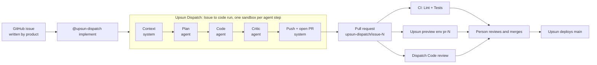

# Upsun Dispatch customer demo: Issue to code + Code review

In 25 minutes, a plain GitHub issue becomes a tested, reviewed pull request running on its own
Upsun Cloud environment, and a person still makes the final call.

> The presenter version of this scenario (with diagrams, kept up to date) lives in the Claude Doc
> "Upsun Dispatch customer demo: Issue to code + Code review". This file is the versioned copy.



## At a glance

| Item | Detail |
| --- | --- |
| Audience | Engineering leaders and developers |
| Duration | 25 min: 6 pitch, 15 live, 4 Q&A |
| App | Trailhead Supply Co., fictional storefront. Node.js 24 + Express 5, no database, one dependency |
| Workflow 1 | Issue to code, triggered by the comment `@upsun-dispatch implement` on a GitHub issue |
| Workflow 2 | Code review, automatic when a PR is opened or pushed |
| CI | GitHub Actions: `Lint` and `Tests` in parallel |
| Environments | Upsun Cloud GitHub integration: one environment per PR (`pr-N`), deleted when the PR closes |
| Models | Your Anthropic or OpenAI key in the Dispatch org |

| Act | Clock | What the audience sees |
| --- | --- | --- |
| 0. Why Dispatch | 0:00 to 6:00 | The problem, the three pillars, how a run works |
| 1. Issue to code | 6:00 to 8:00 | Read the issue, post the trigger, open the run |
| 2. While it runs: Code review | 8:00 to 13:00 | Pre-seeded PR: CI green, env up, yet the review catches an XSS and a crash |
| 3. The Dispatch PR | 13:00 to 19:00 | Plan, critic notes, CI, the `pr-N` env with the feature, the review, a human decides |
| 4. The record | 19:00 to 21:00 | Run detail, audit trail, cost per run, Usage page |
| Q&A | 21:00 to 25:00 | Objections, next steps |

**Live today vs roadmap.** Live: both workflows, sandboxed agent steps, critic step, audit trail, cost
per run, bring-your-own key. The plan-approval gate exists but is Jira-only; on GitHub the human gate is
the PR review and merge. Running/testing a change on a real environment from inside a Dispatch workflow
is roadmap ("Verification"); here the Upsun Cloud GitHub integration provides the environment.

## One-time setup (about 20 minutes)

1. Prerequisites on your Mac: `git`, `gh` (logged in), `upsun` CLI (logged in).
2. From the repo root:
   ```bash
   GITHUB_REPO=<your-org>/dispatch-demo-storefront UPSUN_ORG=<your-upsun-org> ./demo/setup.sh
   ```
   Pushes `main`, `demo/review-showcase` and `demo/golden-stock-status`, creates the `demo` label, creates
   the Upsun project (`UPSUN_REGION`, default `eu-5.platform.sh`; or reuse with `UPSUN_PROJECT=<id>`) and
   adds the GitHub integration with PR environments. It asks `gh` for the `admin:repo_hook` scope.
3. Check production: `upsun url --project <id> --environment main --primary`. No yellow banner on production.
4. Dispatch console: install the GitHub App on the repo; connect a model key; enable Issue to code;
   set Code review trigger mode to **automatic**.
5. GitHub: protect `main` (PR required, `Lint` and `Tests` required).
6. Dry run once end to end and note real timings (see Fallbacks).

## Before each demo (T-30 min)

```bash
GITHUB_REPO=<your-org>/dispatch-demo-storefront ./demo/prepare.sh
```

Creates the Issue to code issue (from `demo/issue.md`) and opens the showcase PR from
`demo/review-showcase` (linked to a "Add a product search" issue), so its CI, environment and review are
done before you start.

- [ ] Showcase PR: checks green, `pr-N` deployed, Dispatch review posted
- [ ] Production loads, Alpine Down Jacket (stock 0) still shows "Add to cart"
- [ ] Dispatch: model key connected, agent-minutes left
- [ ] No open run on the stock-status issue

Tabs: 1 slides (Intro Upsun Dispatch deck: 2, 3, 5, 7, 8, 13) · 2 production on Alpine Down Jacket ·
3 the issue · 4 Dispatch Runs · 5 showcase PR Files changed · 6 showcase `pr-N` env · 7 Upsun console.

## Act 0: Why Upsun Dispatch exists (6 min)

Tagline, quote it exactly: **"Ship at agent speed. Stay in control. Agents handle the volume. Your team holds the line."**

1. **The problem (slide 3).** "Most of you have adopted AI coding tools. Individual engineers feel faster,
   yet the team isn't releasing any faster. AI made writing code faster, and that was no longer the
   bottleneck. Remove it and you expose what sits behind: review queues that grow faster than the team can
   validate, costs finance can't budget, and code reaching production that nobody can fully explain."
2. **Two ways to build with agents (slide 2).** "Vibe coding: one step between prompt and production. To
   validate, hope. Structured delivery: a validation point at every key step, each owned by a person.
   Nothing there is new. What's new is doing it at agent speed."
3. **Why not just Claude Code or Codex? (slide 5).** "They write excellent code. That's one task of nine.
   The PR then becomes the reviewer's, security's and QA's problem, and those tools don't know your
   organization. Claude Code isn't the competitor; it's a component Dispatch docks into a team workflow.
   You replaced one step of the SDLC. Dispatch reimplements the SDLC."
4. **One breath (slide 7).** The platform for governed collaboration between AI agents and
   cross-functional human teams. It answers: **Who decides? What happened? What did it cost? What's waiting?**
5. **Three pillars (slide 8).**

   | Pillar | Problem | In the demo |
   | --- | --- | --- |
   | Collaboration | Engineers ship more code; teams don't ship more product | Product writes the issue, agents build, a person merges |
   | Cost transparency | AI spend scales faster than AI value | Cost per run, then per workflow on the Usage page |
   | Traceability | Code reaches production that nobody can explain | Context, plan, critic notes and reviews on every run |

6. **Four principles (slide 9).** Workflows over agents · Model choice (Anthropic or OpenAI, your key) ·
   Trust, with humans in the loop · Shared context in the cloud.
7. **Bridge.** "Two workflows are GA today: Issue to code and Code review. I'll start one now, and while
   the agents work, I'll show you the other."

Discovery hook: "On the 8 stages of AI engineering maturity (slide 6), where is your team today?"

## Act 1: Issue to code

1. **Production (tab 2):** Alpine Down Jacket has stock 0 but offers "Add to cart". "Product filed an issue."
2. **The issue (tab 3):** created by `prepare.sh` from [`demo/issue.md`](demo/issue.md), identical every time.
   Title: *Show stock status on products (low stock / sold out)*.
3. **Post the trigger** as a new comment, alone, exactly (GitHub won't autocomplete the bot):
   ```text
   @upsun-dispatch implement
   ```
   "That's the whole interface. A mention, from the tool you already use. Same from Jira or Linear."
4. **The run (tab 4).** Walk the steps:
   - Push access check + context gathering (system steps; the bundle is saved on the run).
   - Plan (agent, fresh sandbox) posted on the issue. "On Jira a person approves this plan first; on GitHub
     today the gate is the PR."
   - Code (agent, fresh sandbox, read-only single-repo token injected at the network layer, cannot push).
   - Critic (a second agent checks the diff against the plan; fatal findings block the PR).
   - Push and open (system step) on `upsun-dispatch/issue-<n>`; requester is author, Dispatch co-author.
   - Link back on the issue; the PR triggers Code review.
   "Rather than watch it, let me show you the second workflow on a PR from earlier today."

## Act 2: While it runs, Code review on a human PR

PR "Add catalogue search" (`demo/review-showcase`), hand-written with planted bugs:

| Planted bug | Where | Effect |
| --- | --- | --- |
| Reflected XSS | `src/views.js`, query printed unescaped | `/search?q=<script>alert(1)</script>` runs script |
| User input as regex | `src/app.js`, `new RegExp(req.query.q, 'i')` | `/search?q=(` returns 500; ReDoS risk |
| Thin tests | `test/search.test.js` happy path only | Both bugs pass CI |

1. Checks green. "By the usual rules, this is ready to merge."
2. `pr-N` env (yellow banner): search "tent" works. "Its own environment, same config as production."
3. Dispatch review: inline findings on `views.js` and `app.js`. "It reviews human PRs too."
   Optional: open `/search?q=(` on `pr-N` to show the 500.
4. "The review is evidence, not the verdict. It never merges. Branch protection and a person do."

Commands (entire comment): `@upsun-dispatch review` · `full review` · `cancel` · `help`. Auto reviews cap at 10 per PR.
Review wording varies between runs: read the posted review before the demo and quote it.

## Act 3: The Dispatch PR

1. Issue: the plan comment and the link-back comment.
2. PR description: summary + critic notes. Commit: you are author, Dispatch committer/co-author.
3. Files changed (about 80 lines): `stockStatus()` + named threshold in `catalog.js`, `escapeHtml`,
   tests on 0/1/5/6. "It followed `AGENTS.md`."
4. CI green; open `pr-N`: Alpine Down Jacket "Sold out" + disabled button; Ridge Trail Shoes "Only 3 left";
   Headlamp 400 "Only 1 left"; Summit 35 no badge.
5. Code review on the agent's PR. "One agent wrote it, another critiqued it, a third reviewed it, CI tested
   it, it runs on its own environment. Now a person decides."
6. Recommended: don't merge; "this is where your senior engineer clicks merge and Upsun deploys with zero downtime."

## Act 4: The record and the cost, then close

1. Dispatch run detail: trigger, context, plan, step outcomes, critic, PR; then the Code review runs.
   "Six months from now an auditor asks why this change exists: it's all here."
2. Cost on the run, then Usage by workflow and repo. Tokens on your provider bill, no markup; agent time
   from a prepaid wallet; no per-seat price, no repo limit; 20 free agent-minutes a day.
3. Close: "An issue written by product became a reviewed PR, tested by CI, running on its own Upsun Cloud
   environment, with a full record and a known cost. Agents did the volume. A person held the line."

Next step: trial on one repo, Code review in automatic mode first, then Issue to code on small tickets.

## Q&A

| They ask | Answer |
| --- | --- |
| "We have Claude Code / Copilot." | Keep them; they accelerate one step of nine. Dispatch runs the team workflow around it. |
| "Won't gates slow us?" | The team chooses gates. Plan approval on/off per org; review is advisory. |
| "Agent reviews its own PR?" | Writer, critic, reviewer are separate steps and sandboxes. Dispatch never merges. |
| "Is our code safe?" | One sandbox per step, destroyed after. Planner has no outbound network. Coder has a read-only token and cannot push. |
| "Which model?" | Yours: Anthropic or OpenAI, per org and workflow. |
| "Cost?" | Provider tokens + prepaid agent time; no seats, no repo limit; cost shown per run. |
| "GitLab / Jira / Linear?" | All live. Issue to code PR publishing to GitLab isn't supported yet; Code review works on GitLab MRs. |
| "Custom steps?" | Not yet; editable workflows are next on the roadmap. No dates. |
| "Must we host on Upsun?" | No. Deployment stays in your pipeline. |

## Fallbacks and reset

| If | Then |
| --- | --- |
| Nothing starts | Comment must be exactly the trigger, a new comment, no active run; GitHub App installed |
| Run fails / critic blocks | Make it a point, then open a PR from `demo/golden-stock-status` (tested implementation) |
| Run is slow | Stay on Act 2 longer (run detail, Usage page) |
| Env still building | Show the Upsun activity log |
| No review findings | `@upsun-dispatch full review` before the demo; or show `/search?q=(` yourself |
| Network down | Use a recording of your dry run |

Expected timings (measure yours): Issue to code about 4 to 5 min (internal test: 4 min 18 s, $0.60) ·
CI under 30 s per job · `pr-N` env 1 to 3 min · Code review about 2 min.

Reset after each demo:

```bash
GITHUB_REPO=<your-org>/dispatch-demo-storefront ./demo/reset.sh
```

Closes Dispatch and demo PRs (Upsun removes their environments), deletes `upsun-dispatch/*` branches,
closes `demo` issues. `main` is untouched; if you merged during a demo, `git revert` it.
